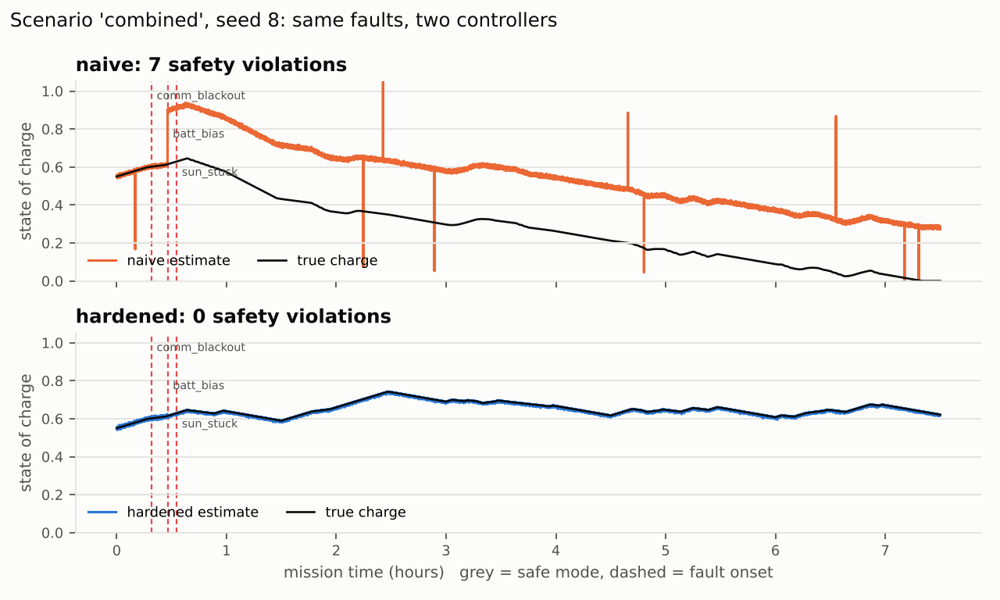
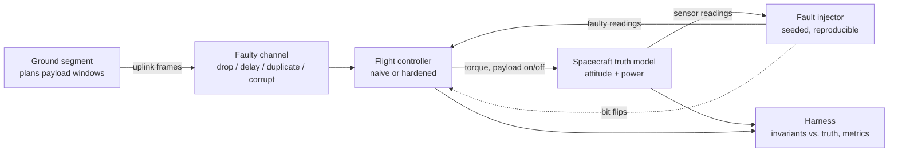
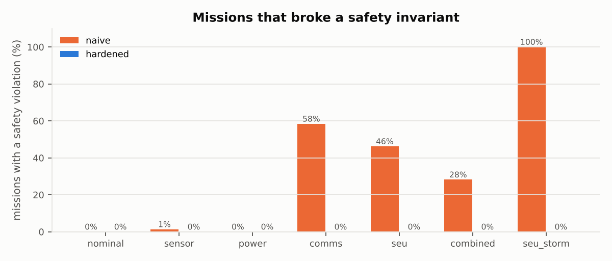
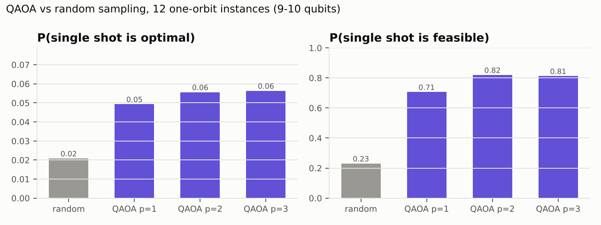

# Bad Day in Orbit

A flight-software fault-injection lab. A small simulated spacecraft, two
versions of its flight controller, and a test campaign that tries to break
them thousands of times: sensors that lie, a ground link that drops,
duplicates and corrupts commands, a battery that fails, and radiation flipping
bits in flight computer memory.

The question it answers is not "does the controller work" but "what does the
controller do when the system around it stops working, and can I prove it".



*One seed from the `combined` scenario. A comm blackout, a battery voltage
sensor that starts reading high and a frozen sun sensor all land within a few
minutes. The naive controller believes the battery sensor, keeps running the
payload and drains the real battery to zero. The hardened controller flags
the battery sensor 29 s after it starts lying and the frozen sun sensor after
10 s, keeps an accurate estimate and finishes the mission. Reproduce with `python3 tools/plot_run.py --scenario combined --seed 8`.*

## How it works



- **Spacecraft model** (`src/spacecraft.cpp`): one rotation axis (solar panel
  angle to the sun) and an energy-balance battery. Small on purpose: just
  enough for a lying sensor to cause mispointing, mispointing to cost power,
  and power to matter. 90 minute orbit with eclipse and one ground pass.
- **Fault injector** (`src/faults.cpp`): builds a fault timeline from
  `(scenario, seed)`. The same seed gives the same faults to both controllers,
  so every comparison is paired.
- **Controllers**: same interface, same attitude gains, so differences come
  from fault handling and not tuning.
- **Harness** (`src/harness.cpp`): checks safety invariants against ground
  truth, never against what the controller believes about itself.

### Safety invariants

| Invariant | Meaning |
|---|---|
| `deep_discharge` | true state of charge below 10% |
| `payload_low_power` | payload running while true charge is below 20% |
| `invalid_mode` | the mode variable holds a value that is not a mode |
| `payload_in_safe` | payload running while in safe mode |
| `duplicate_exec` | the same command sequence number executed twice |
| `stale_exec` | a command older than 60 s executed |

### The two controllers

**Naive** (`src/naive_controller.cpp`) is what you get when everything is
written for the nominal case: trusts its primary sun sensor, trusts the
battery voltage, parses uplink frames without checking the CRC, keeps one copy
of its state, and drops to safe mode on any single out-of-range reading.

**Hardened** (`src/hardened_controller.cpp`):

- **Memory.** Mode, payload latch and last command sequence number are stored
  in triple modular redundancy (`include/bdio/tmr.hpp`) and scrubbed every
  cycle with a bitwise majority vote. Mode values are encoded with a minimum
  Hamming distance of 4, so one flipped bit can never turn one valid mode into
  another. The command table is stored twice with a CRC on each copy.
- **Uplink.** CRC-16/CCITT on every frame, rejects replayed or duplicate
  sequence numbers and anything older than 60 s.
- **Attitude.** Two sun sensors cross-checked against gyro propagation. A
  sensor is declared failed only after 5 consecutive disagreements, or 10
  bit-identical samples (a real sensor is never that quiet). Gyro bias is
  estimated online.
- **Power.** Battery voltage cross-checked against coulomb counting, with
  asymmetric trust: a reading that says there is *less* energy than expected
  is believed after 10 s, one that says there is *more* has to keep agreeing
  for 30 s. Being wrong in the first direction costs science; in the second it
  costs the spacecraft.
- **Mode logic.** Persistence and hysteresis on every transition. Safe mode
  exits through a recovery state that has to hold for 5 minutes. A degraded
  mode with tighter power margins runs when redundancy is lost or the ground
  has been silent for 1.5 orbits, and an onboard scheduler
  (`src/scheduler.cpp`) picks payload targets when there is no plan.
- **No dynamic allocation** in the control loop, enforced by a test that
  replaces `operator new` and counts calls during a full mission.

## Results

1000 missions per scenario per controller (7.5 hours of simulated time each,
14,000 missions total), identical seeds for both controllers. Full tables in
[`results/summary.md`](results/summary.md).



| Scenario | Naive: missions with a violation | Hardened: missions with a violation | Naive: false safe-mode entries / mission | Hardened: false safe-mode entries / mission |
|---|---:|---:|---:|---:|
| nominal | 0.0% | 0.0% | 10.36 | 0.00 |
| sensor | 1.3% | 0.0% | 5.91 | 0.00 |
| power | 0.0% | 0.0% | 3.80 | 0.00 |
| comms | 58.4% | 0.0% | 4.29 | 0.00 |
| seu | 46.2% | 0.0% | 3.32 | 0.00 |
| combined | 28.2% | 0.0% | 1.89 | 0.00 |
| seu_storm | 100.0% | 0.0% | 0.00 | 0.00 |

What the numbers say, including the parts that do not flatter the hardened
controller:

- **Single faults are mostly survivable even for the naive controller.**
  A lying sun sensor alone caused a violation in 1.3% of missions. The damage
  comes from combinations and from the parts of the system the naive code
  trusts blindly: the uplink (58% of missions) and its own memory (46%).
- **False alarms are a real cost.** The naive controller drops to safe mode
  about 10 times per mission *with no faults at all*, because a single noisy
  sample is enough. Persistence filters remove all of them.
- **Safety costs science.** In the power scenario the hardened controller
  delivered 90% of planned payload time against the naive 99%: when it doubts
  the battery it raises its margins. The naive controller's 99% is the same
  behaviour that drains the battery when a second fault arrives.
- **Detection is not perfect.** Across all scenarios the hardened controller
  detected 74-100% of each fault type (table below). The worst case is a real
  battery cell loss while the voltage sensor is frozen: with that sensor stuck,
  nothing onboard can observe the loss.
- **Zero violations means zero violations of the faults modelled here.** The
  fault models and the controller were developed together. That is the main
  limitation of this kind of test, and the reason the fault models are kept
  in one file that can be extended independently.

| Fault (hardened controller) | Observable events | Detected | Mean detection latency |
|---|---:|---:|---:|
| battery sensor bias | 1011 | 100.0% | 25.4 s |
| battery sensor frozen | 989 | 100.0% | 10.0 s |
| battery cell loss | 599 | 74.5% | 9.0 s |
| gyro bias jump | 614 | 96.7% | 557.0 s |
| sun sensor bias | 645 | 91.6% | 328.8 s |
| sun sensor noise | 488 | 91.0% | 50.3 s |
| sun sensor frozen | 598 | 95.8% | 10.1 s |
| single event upset | 2,785,292 | 100.0% | same cycle |

Latency is measured from fault onset, so a sensor fault that starts in eclipse
is not detectable until the sun comes back; that is most of the sun sensor
and gyro latency. Faults that never change a reading (start and end in
eclipse) are excluded and counted separately.

### What broke during development

The campaign found real problems in the hardened controller, including one
where it spent half of every *fault-free* mission in degraded mode, and one
where a safe design choice cost 95% of science under radiation. Each is written
up with the before and after numbers in
[`docs/ENGINEERING_LOG.md`](docs/ENGINEERING_LOG.md).

### Timing

`bdio_bench` measures one control cycle over 10^6 cycles of the combined
scenario. Ranges are over two runs (Release build, containerised Linux, no
real-time scheduling):

| | p50 | p99 | p99.9 |
|---|---:|---:|---:|
| naive | 35-42 ns | 53-63 ns | 78-91 ns |
| hardened | 0.66 us | 0.80-0.92 us | 12.6-15.3 us |

The hardened median is dominated by verifying both CRC copies of the command
table every cycle. The p99.9 tail has not been traced to a cause yet (candidates:
cache misses on cycles that repair memory, or host noise). The maximum is not
reported because on a desktop OS it measures the scheduler, not the code; on a
flight target the worst case would come from analysis, not a histogram.

## Quantum replanning experiment

After a recovery, or when the ground link returns, the payload plan has to be
rebuilt: choose targets to maximise science value with no overlapping windows
and the energy spent inside the battery budget. That is a knapsack problem with
conflicts, and it maps onto a QUBO, the form quantum annealers and QAOA work
on. `quantum/` formulates it, solves it four ways, and compares them honestly.

Results over 12 random instances per size (`results/quantum_benchmark.md`):

| Solver | 1 orbit (6 targets, 9-10 qubits) | 2 orbits (12 targets, 16-17 qubits) |
|---|---:|---:|
| Exact search | 12/12 optimal | 12/12 optimal |
| Greedy (the onboard policy) | 10/12 optimal, 98.3% of optimum on average | 9/12 optimal, 98.7% |
| Simulated annealing on the QUBO | 12/12 optimal | 3/12 optimal, 96.1% |



QAOA (Qiskit statevector simulation, 4096 shots, COBYLA, 2 restarts):

| | P(one shot is the optimal plan) | P(one shot is a feasible plan) |
|---|---:|---:|
| Uniform random bits, 1 orbit | 0.021 | 0.230 |
| QAOA p=1, 1 orbit | 0.049 | 0.706 |
| QAOA p=2, 1 orbit | 0.056 | 0.820 |
| QAOA p=3, 1 orbit | 0.056 | 0.812 |
| Uniform random bits, 2 orbits | 0.001 | 0.127 |
| QAOA p=1, 2 orbits (3 instances) | 0.001 | 0.722 |

Reading this honestly:

- At these sizes there is no case for a quantum computer. Exact search takes
  milliseconds and the cheap onboard greedy policy is within 2% of optimal.
- "Best of 4096 shots found the optimum" is true for every QAOA run, and
  meaningless: drawing 4096 samples from a 10 qubit space finds the optimum by
  brute force. The number that matters is the probability per shot.
- Shallow QAOA learns the *constraints* well (70-82% of shots are feasible
  plans versus 13-23% at random) but only modestly concentrates probability on
  the *optimum* (2-3x random at one orbit, no better than random at two).
- Simulated annealing on the same QUBO also degrades at two orbits. The
  penalty terms that encode the constraints make the energy landscape rugged
  for both methods. Better formulations (fewer slack bits, tuned penalties)
  are where the real work would be.

The QUBO uses slack bits to turn the energy budget into an equality, and a
penalty weight just above the largest single target value so that every
infeasible assignment costs more than the best feasible one
(`quantum/problem.py`). Tests check that the QUBO minimum equals the true
optimum and that every ground state is a feasible plan. The target catalog is
parsed from `include/bdio/scheduler.hpp`, so the benchmark and the onboard
scheduler always solve the same problem.

`quantum/qaoa.py` also has `run_on_ibm()` for sampling the optimised circuit on
IBM Quantum hardware. It needs `qiskit-ibm-runtime` and a saved account and
has not been run yet.

## Build and run

Requires a C++20 compiler and CMake 3.20+. GoogleTest is fetched
automatically if it is not installed.

```sh
cmake -S . -B build
cmake --build build -j
ctest --test-dir build

# one mission, with flight recorder output
./build/bdio_run --scenario combined --seed 8 --controller hardened --csv run.csv --events events.csv

# full campaign and report
./build/bdio_campaign --runs 1000 --out results/campaign.jsonl
python3 tools/report.py results/campaign.jsonl --out results

# timing
./build/bdio_bench

# sanitizers
cmake -S . -B build-asan -DBDIO_SANITIZE=ON -DCMAKE_BUILD_TYPE=Debug && cmake --build build-asan -j && ctest --test-dir build-asan

# quantum benchmark
pip install -r quantum/requirements.txt
cd quantum && python3 -m pytest -q && python3 benchmark.py --out ../results
```

Scenarios: `nominal`, `sensor`, `power`, `comms`, `seu`, `combined`,
`seu_storm`.

## Limitations

- The physics is a single rotation axis and an energy balance. Good enough to
  connect sensor faults to power consequences, nowhere near a real attitude or
  power model.
- Upsets are only injected into the controller's critical discrete state
  (mode, latches, command table). Estimator variables, the stack and code are
  not targets.
- The current sensor used for coulomb counting is never faulted.
- Timing comes from a desktop OS and says nothing about a real flight
  processor.
- Controller and fault models were written together. An independent set of
  fault models would be a stronger test.
- Nothing here is flight software or derived from any real mission.

## Layout

```
include/bdio/   headers: types, TMR, CRC, packet format, controllers, harness
src/            spacecraft model, fault injector, controllers, scheduler, harness
apps/           bdio_run, bdio_campaign, bdio_bench
tests/          GoogleTest suite and the allocation test
tools/          campaign report and replay plots
quantum/        QUBO formulation, classical solvers, QAOA, benchmark, tests
results/        committed outputs of the last full campaign
docs/           engineering log
```
